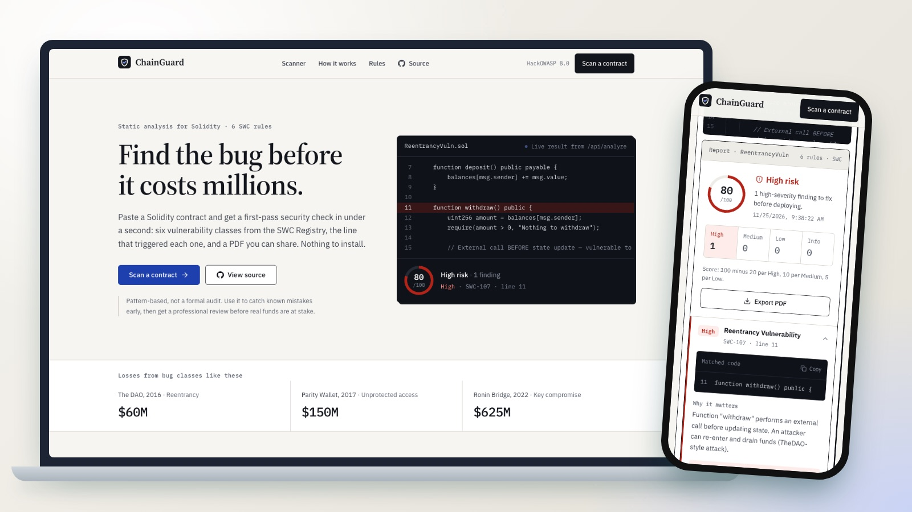
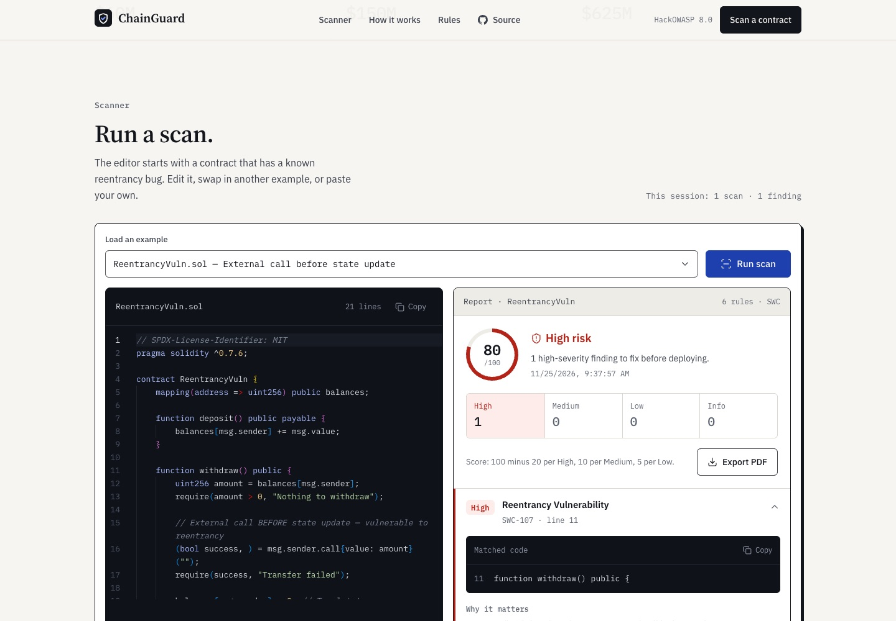
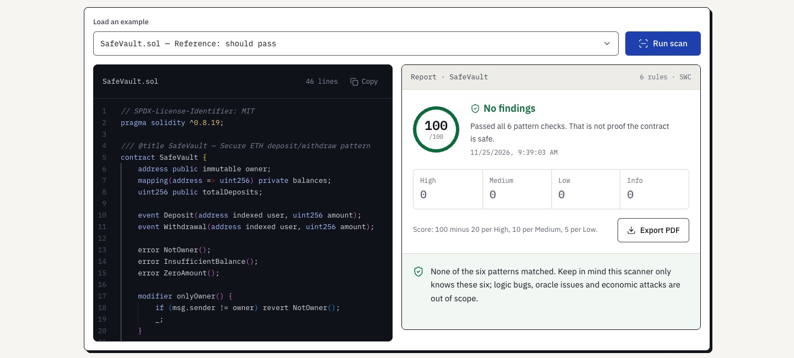
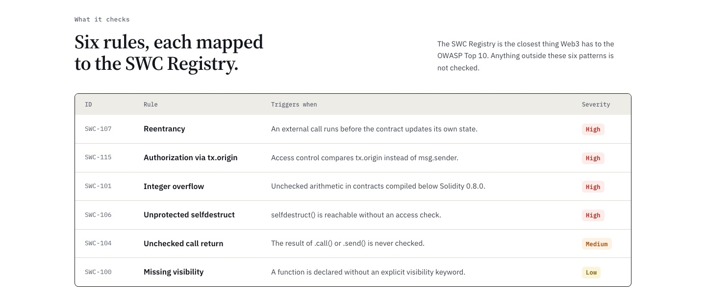
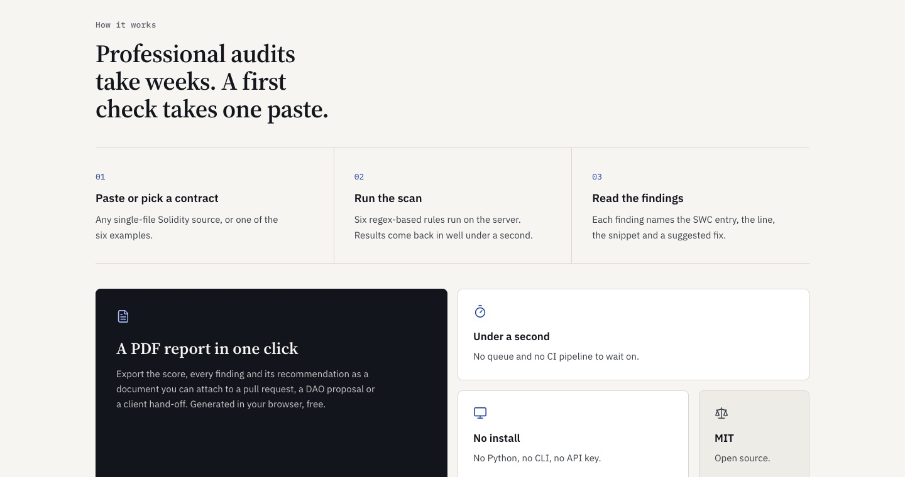
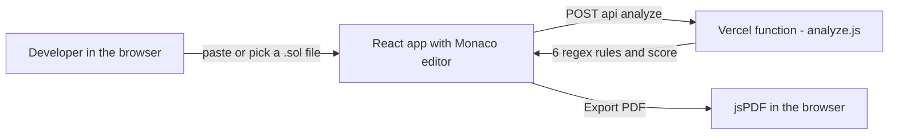

<div align="center">


# ChainGuard

### Find the bug before it costs millions: a first-pass security check for Solidity contracts, right in the browser.

[](https://chainguard-pi.vercel.app)
[](#-hackathon)
[](LICENSE)


<br/>


<br/>



**[▶ Scan a contract](https://chainguard-pi.vercel.app/#scanner)** · **[How it works](#-how-it-works)** · **[Rules](#-rules)** · **[Design notes](docs/DESIGN_NOTES.md)**

</div>

> [!NOTE]
> ChainGuard is **pattern-based, not a formal audit**. Use it to catch known mistakes early, then get a professional review before real funds are at stake. Anything outside its six patterns (logic bugs, oracle issues, economic attacks) is out of scope.

---

## 🎯 The problem

Smart contracts are **immutable once deployed**, and a single bug can drain millions: The DAO (2016, reentrancy, $60M), Parity Wallet (2017, unprotected access, $150M), Ronin Bridge (2022, key compromise, $625M). Most developers don't have easy access to audit tooling: Slither needs Python and a CLI, MythX is paid, and manual audits take weeks.

## 💡 The solution

Paste a Solidity contract (or pick one of the six built-in examples) and get a report in well under a second:

- a **verdict and security score** (0–100: 100 minus 20 per High, 10 per Medium, 5 per Low), where a High finding always outranks the number, so the report never says "secure" with a High issue open;
- each finding with its **SWC id, the affected line, the matched code, why it matters and a suggested fix**;
- a **PDF audit report** generated in the browser, ready to attach to a pull request, a DAO proposal or a client hand-off.

No install, no account, no API key.

## ✨ Features

<table>
<tr>
<td width="50%"><br/><b>Report with verdict:</b> <code>ReentrancyVuln.sol</code> gets "High risk", score 80 and one SWC-107 finding at line 11, opened by default with the matched code.</td>
<td width="50%"><br/><b>Honest "no findings":</b> <code>SafeVault.sol</code> passes all six checks, and the report says that is not proof the contract is safe.</td>
</tr>
<tr>
<td width="50%"><br/><b>Six rules mapped to the SWC Registry</b>, the closest thing Web3 has to the OWASP Top 10.</td>
<td width="50%"><br/><b>Paste, run, read:</b> Monaco editor, <kbd>Ctrl</kbd>/<kbd>Cmd</kbd>+<kbd>Enter</kbd> to scan, and one-click PDF export.</td>
</tr>
</table>

## 🔎 Rules

| Rule | SWC ID | Severity | Triggers when |
|------|--------|----------|---------------|
| Reentrancy | SWC-107 | High | An external call runs before the contract updates its own state |
| Authorization via tx.origin | SWC-115 | High | Access control compares `tx.origin` instead of `msg.sender` |
| Integer overflow | SWC-101 | High | Unchecked arithmetic in contracts compiled below Solidity 0.8.0 |
| Unprotected selfdestruct | SWC-106 | High | `selfdestruct()` is reachable without an access check |
| Unchecked call return | SWC-104 | Medium | The result of `.call()` or `.send()` is never checked |
| Missing visibility | SWC-100 | Low | A function is declared without an explicit visibility keyword |

Example contracts for each rule live in [`contracts/`](contracts/README.md) (five vulnerable, one safe reference).

## 🧠 How it works



- **Primary API:** `frontend/api/analyze.js`, a zero-dependency Vercel serverless function on the same domain as the app (no CORS).
- **Alternative deployment:** the same analyzer as a Supabase Edge Function (`supabase/functions/analyze`); the current frontend only calls `/api/analyze`.
- **Standalone backend:** `backend/` is an Express + TypeScript service using `@solidity-parser/parser`, with Railway config; the deployed site uses the Vercel function.
- jsPDF is loaded only when someone exports a report.

### ChainGuard vs. other tools

| Feature | ChainGuard | Slither | MythX | Remix Analyzer |
|---------|-----------|---------|-------|----------------|
| Zero install, runs in browser | ✅ | ❌ needs Python | ❌ needs CLI | ✅ |
| Instant results (< 1 second) | ✅ | ⚠️ slow on large contracts | ❌ minutes | ✅ |
| PDF audit report export | ✅ | ❌ | ✅ paid | ❌ |
| Security score (0–100) | ✅ | ❌ | ⚠️ partial | ❌ |
| Line-level code snippets | ✅ | ✅ | ✅ | ⚠️ |
| Fix recommendations per issue | ✅ | ⚠️ terse | ✅ | ⚠️ |
| Free & open source | ✅ | ✅ | ❌ | ✅ |

ChainGuard trades depth for speed and accessibility: Slither and MythX analyze far more than six patterns.

## 🛠️ Stack

| Layer | Technology |
|:--|:--|
| Frontend | React 18 · Vite 5 · TypeScript · Tailwind CSS · Monaco Editor (`@monaco-editor/react`) · axios |
| Reports | jsPDF (lazy-loaded) |
| Analysis API | Vercel serverless function (Node.js, regex rules) · Supabase Edge Function (alternative) |
| Alternative backend | Express · TypeScript · `@solidity-parser/parser` (Railway) |
| Hosting | Vercel |

## 🚀 Run it locally

```bash
git clone https://github.com/ALFA117/CHAINGUARD
cd CHAINGUARD/frontend
npm install
npm run dev   # → http://localhost:5173
```

<details>
<summary><b>Local API and deploy</b></summary>

The API route runs via `vercel dev` or directly on Vercel:

```bash
npm install -g vercel
vercel dev    # serves both frontend and /api/analyze
```

Frontend and API both deploy to **Vercel** from the `frontend/` directory:

```bash
cd frontend
vercel --prod
```

Supabase Edge Function (optional, alternative deployment):

```bash
supabase functions deploy analyze --project-ref <your-project-ref>
```

Standalone backend: `cd backend && npm install && npm run dev` (Express on port 3001).

</details>

## 🗺️ Roadmap

- [ ] File upload (.sol drag-and-drop)
- [ ] Slither integration for deeper analysis
- [ ] CI/CD GitHub Action that comments on PRs with audit results
- [ ] Multi-contract / multi-file analysis
- [ ] VS Code extension
- [ ] Historical scan tracking per wallet/project

## 🏆 Hackathon

Built for **HackOWASP 8.0**, Web3 + Cybersecurity track.

## 📄 License

[MIT](LICENSE)

---

<div align="center">

<sub>Built by <a href="https://github.com/ALFA117">ALFA117</a> (<a href="https://www.instagram.com/alfa_edg_/">@ALFA_EDG_</a>) for HackOWASP 8.0</sub>

</div>
